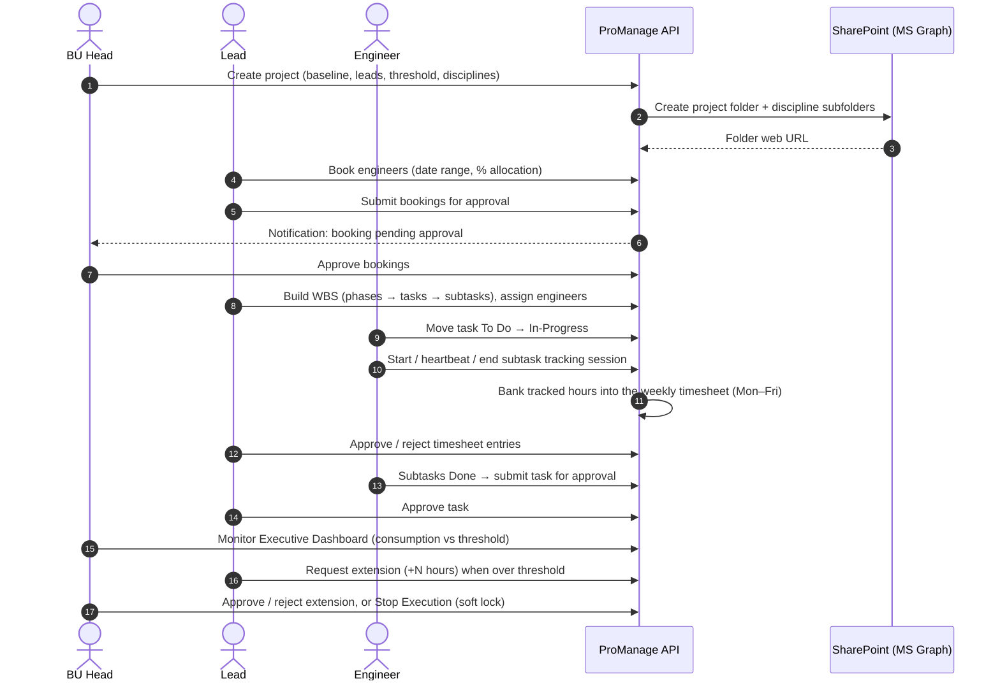
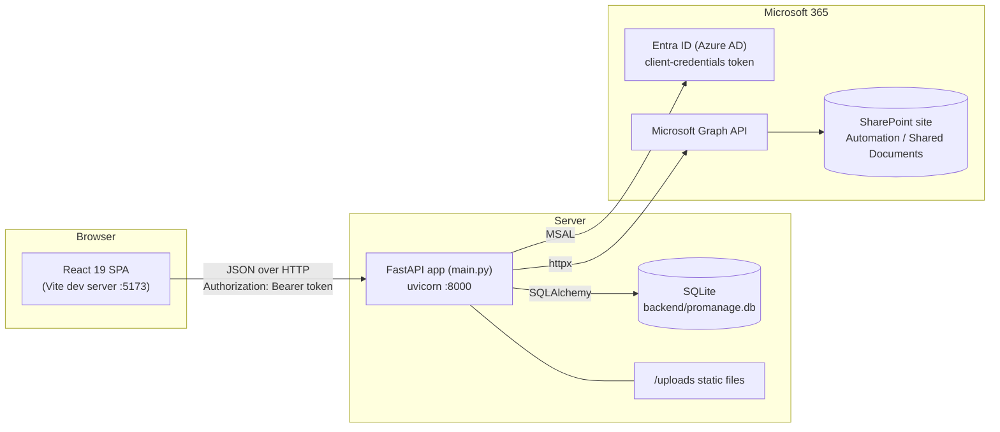
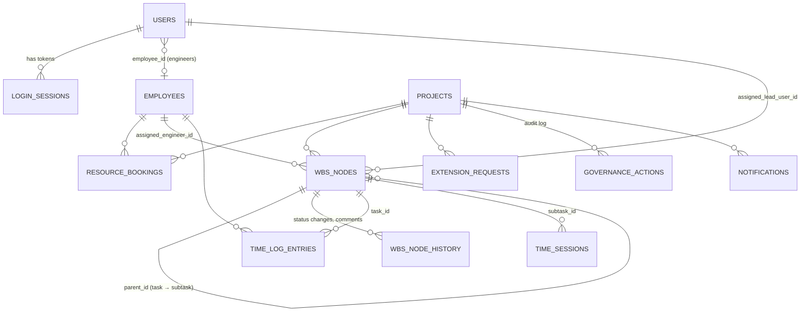
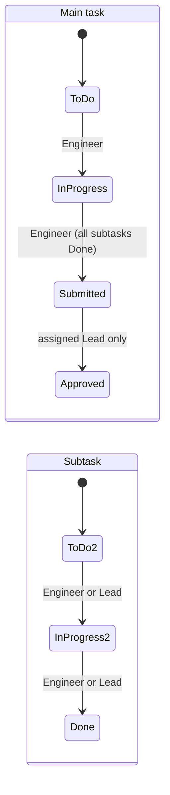

# MAEC Project Management — Project Guide

> A complete description of the product, how it works end to end, and how the code is organised.
> Reflects the code on `main` after roadmap Phase 1 (BU Head modules moved into `backend/app/`), September 2026.

## Contents
1. [What the product is](#1-what-the-product-is)
2. [Roles and responsibilities](#2-roles-and-responsibilities)
3. [End-to-end lifecycle](#3-end-to-end-lifecycle)
4. [System architecture](#4-system-architecture)
5. [Repository structure](#5-repository-structure)
6. [Backend](#6-backend)
7. [Business rules](#7-business-rules)
8. [API reference](#8-api-reference)
9. [SharePoint integration](#9-sharepoint-integration)
10. [Frontend](#10-frontend)
11. [Configuration](#11-configuration)
12. [Development workflow](#12-development-workflow)
13. [Known issues and technical debt](#13-known-issues-and-technical-debt)
14. [Roadmap](#14-roadmap)
15. [Glossary](#15-glossary)

---

## 1. What the product is

MAEC Project Management (code name **ProManage**) is an internal web application for **MAEC (Mirage AEC)**, an MEP engineering consultancy (Mechanical, Electrical, Plumbing, plus BIM modelling). It controls the full life of a design project, from commercial setup to delivery:

- **Commercial baseline.** Each project has a contract value, a target number of effort hours and an alert threshold (for example 80%).
- **Document storage.** Creating a project provisions a SharePoint folder structure automatically.
- **Resourcing.** Leads book engineers onto projects, capped at 100% allocation per engineer across all projects. The BU Head approves the booking.
- **Planning.** Leads break the scope into a **WBS** (Work Breakdown Structure) grouped into five fixed design phases.
- **Execution.** Engineers move tasks through a status workflow. Their working time on subtasks is tracked automatically.
- **Control.** Leads approve timesheets and finished tasks. The BU Head watches hours and budget consumption against the threshold, and can approve or reject requests for more hours or stop execution entirely.

The core idea is **governance of effort**: hours are the unit of cost. Every hour a Lead approves counts against the project's baseline (the BU Head's target effort hours plus approved extensions). Crossing the alert threshold notifies the BU Head and the project's Leads, and reaching 100% locks timesheets automatically until the BU Head approves an extension or resumes execution.

---

## 2. Roles and responsibilities

There are three roles. The role comes only from the logged-in account, never from the URL or the browser.

| Role | Responsibilities | Pages (tabs) |
|---|---|---|
| **BU Head** (Business Unit Head) | Creates projects and their commercial baseline. Owns SharePoint provisioning. Approves resource bookings. Monitors hours, budget and schedule. Approves or rejects extension requests. Can stop execution (soft-lock timesheets). Read-only view of WBS, tasks and timesheets. | Projects (Created Projects), Create Project, Resource Booking, WBS Structure, Timeline & Logs, Executive Dashboard, Work Summary, SharePoint Mirror |
| **Lead** (discipline lead: Electrical, Mechanical or BIM) | Books engineers and submits bookings for approval. Builds the WBS (manually or by CSV/XLSX upload). Assigns engineers. Moves subtasks forward. Approves submitted tasks. Approves or rejects engineers' timesheet entries. Requests extra hours from the BU Head. | Resource Booking, WBS Structure, Timeline & Logs, Executive Dashboard, SharePoint Mirror |
| **Engineer** | Works on assigned WBS tasks and subtasks. Plans own subtasks. Moves task status forward and submits tasks for approval. Adds comments. Working time on subtasks is tracked automatically. | WBS Structure, Timeline & Logs, Performance Dashboard, SharePoint Mirror |

**How identity connects to data**
- A **User** is a login account (`users` table).
- An **Employee** is an HR record (`employees` table), seeded from the HR CSV.
- **Engineers** are linked to their Employee through `users.employee_id`. WBS assignments, bookings and timesheets all reference `employees.id`.
- **Leads** are identified by `users.id`. Projects store the three lead user IDs (`project_lead_electrical_user_id` and so on), and WBS nodes store `assigned_lead_user_id`. Older rows without an ID fall back to matching the lead's full name.
- A lead's **discipline** (`users.discipline` = Electrical / Mechanical / BIM) filters the lead dropdowns on Create Project.

---

## 3. End-to-end lifecycle



Step by step:

1. **Project creation (BU Head).** Fill in the Create Project form: name, unique code, client, one lead per discipline, start date, currency and contract value, target effort hours, alert threshold, and the SharePoint discipline folders to create. The API saves the project, then calls Microsoft Graph to create `…/Project/<Project Name>/` plus a subfolder per selected discipline. If SharePoint fails, the project is still created and the error is returned.
2. **Resource booking (Lead → BU Head).**
   - The Lead books engineers onto the project with a date range and a booking % (20–100).
   - Planned hours are calculated by the server: weekdays in the range × 8.
   - An engineer's bookings across **all** projects may not exceed 100%.
   - The Lead submits the whole project's bookings. They become `pending_approval` and the BU Head gets a notification. The BU Head approves them, making them `approved`.
3. **WBS planning (Lead).**
   - The Lead creates tasks inside the five fixed phases, by hand or by uploading a CSV/XLSX.
   - Only engineers booked on the project can be assigned.
   - A task's estimated hours are weekdays between its start and end dates × 8.
   - Subtasks are single-day units of 1–4 hours. Leads can create them, and engineers can create them under their own tasks.
4. **Execution (Engineer).**
   - The engineer opens a subtask in Task Details and presses Login to start **automatic time tracking**. Only active time counts (idle for more than 2 minutes or a hidden tab stops the count), with a cap of 8 hours per day.
   - On Logout, the tracked hours are added to that day's column in the weekly timesheet row for the subtask.
   - The engineer moves statuses forward. A task can be submitted only once all its subtasks are Done.
5. **Review (Lead).** The Lead approves or rejects timesheet entries (Timeline & Logs), and approves submitted tasks (Task Details).
6. **Governance (BU Head).**
   - The Executive Dashboard shows budget burn, hours consumption against the baseline, the governance level (normal / alert / baseline reached), an SPI-style index and a monthly chart.
   - Reaching the alert threshold notifies the BU Head and the project's Leads. Reaching 100% of the baseline **locks timesheets automatically** and notifies them.
   - An allocated Lead can request an extension of N hours (the BU Head is notified). Approving it raises the baseline and lifts the lock; the Lead is notified of either decision.
   - The BU Head can **Stop the Execution** (soft-lock timesheets) and **Resume Execution** at any time. While locked, engineers can't log hours or start tracking, and Leads can't approve.
   - Every action, including the automatic lock, is written to the governance audit log.
7. **Oversight (BU Head).** The Project Work Summary shows per-lead and per-engineer contribution. The SharePoint Mirror shows the project's live folder tree and files.

---

## 4. System architecture



| Layer | Technology | Notes |
|---|---|---|
| Frontend | React 19, React Router 7, TanStack Query 5, Vite 8, Vitest, lucide-react icons | BU Head pages use a shared API client + query hooks; Lead/Engineer pages still `fetch` directly. Custom CSS; charts built from `<div>`s |
| Backend | FastAPI 0.141, Pydantic 2 (+ pydantic-settings), SQLAlchemy 2, uvicorn | Auth and BU Head code live in the layered `app/` package (routers → services → repositories). Lead/Engineer endpoints are still in `main.py` |
| Database | SQLite (WAL mode) via `DATABASE_URL`; Postgres-ready | Schema created by `create_all` plus `ALTER TABLE` statements run at startup (no migration tool yet) |
| Auth | PBKDF2-SHA256 password hashes, opaque bearer tokens in `login_sessions` | Tokens don't expire; logout deletes the token |
| Integration | MSAL (app-only / client-credentials) + httpx → Microsoft Graph v1.0 | Folder provisioning and read-only mirror |

**Runtime in development:** two processes. Vite on port 5173 serves the React source with hot reload; uvicorn on port 8000 serves the API. The browser calls the API across origins (CORS allows any `localhost` port). A single-port mode, where FastAPI serves the built frontend, is planned.

---

## 5. Repository structure

```
MAEC_project_management/
├── README.md                  Setup, run and quality-check commands
├── CONTRIBUTING.md            Ownership, working-on-main workflow, coding standards, lint ratchet
├── .gitignore                 Excludes venv, node_modules, .env, *.db, data CSVs, builds
├── .pre-commit-config.yaml    Hooks: ruff, prettier, eslint, secret/data blocker
├── docs/
│   └── PROJECT_GUIDE.md       This document
├── _archive/                  Old databases + sample WBS upload files (tests/upload_*.csv|xlsx)
│
├── backend/                   FastAPI service (run from this folder)
│   ├── main.py                App object, startup migrations and seeding, Lead/Engineer endpoints; mounts app routers (~2,800 lines)
│   ├── app/                   Layered package (auth + BU Head + SharePoint), see §6.4
│   │   ├── core/              config (settings), database, security (auth, role guards), roles, errors
│   │   ├── domain/            timesheets (Mon–Fri totals), calendar (monthly spreading)
│   │   ├── repositories/      projects, users, governance, bookings, notifications, work
│   │   ├── services/          access, metrics, projects, documents, governance, booking_approval, notifications, work_summary
│   │   ├── integrations/sharepoint/  DocumentStorage interface (storage.py) + Graph client (graph.py)
│   │   └── api/               deps.py (service wiring), routers/auth.py, routers/bu_head/{projects,governance,resourcing}.py
│   ├── models.py              SQLAlchemy models (14 tables)
│   ├── schemas.py             Pydantic request/response models, status and phase constants
│   ├── database.py            Shim re-exporting app.core.database (old imports keep working)
│   ├── auth.py                Shim re-exporting app.core.security
│   ├── create_user.py         CLI to create login accounts (the only way to add users)
│   ├── seed_and_verify.py     Older end-to-end smoke script (TestClient)
│   ├── seed_users.py, check_users.py, inspect_db.py, temp_*.py, leads_loader.py
│   │                          Leftover dev scripts, mostly dead code (roadmap 1.6)
│   ├── data/
│   │   ├── employee_leads.example.csv   Column layout of the HR export (fake data)
│   │   └── employee_leads.csv           Real HR export — git-ignored, contains personal data
│   ├── uploads/               Served at /uploads (reserved for proposal/SOW files; unused)
│   ├── tests/                 pytest characterization suite for the BU Head API (77 tests)
│   │   ├── conftest.py        Isolated temp DB, SharePoint disabled, fixtures (world, make, client)
│   │   ├── factories.py       Test data builders
│   │   └── test_*.py          auth, projects, sharepoint_mirror, resource_approval,
│   │                          governance, work_summary, oversight_views
│   ├── requirements.txt       Runtime dependencies (pinned)
│   ├── requirements-dev.txt   + pytest, ruff, pre-commit
│   ├── pyproject.toml         ruff + pytest configuration (legacy-file ratchet list)
│   ├── .env.example           Config template (database, Azure, SharePoint)
│   ├── README.md, USERS.md, SHAREPOINT_SETUP.md
│   └── .venv/                 Local virtualenv (git-ignored)
│
└── frontend/                  React SPA
    ├── index.html, vite.config.js, package.json
    ├── eslint.config.js, .prettierrc.json, .prettierignore
    ├── .env.example           VITE_API_BASE_URL
    └── src/
        ├── main.jsx           React root
        ├── App.jsx            Router: lazy-loaded routes, role guards, home redirect per role; wraps QueryProvider
        ├── AuthContext.jsx    Login/logout/me, token in localStorage, authHeaders()
        ├── styles.css         Shared application styles
        ├── assets/maec-logo.png
        ├── api/               client.js (base URL, bearer token, ApiError), projects/governance/sharepoint.js,
        │                      queryClient.js (TanStack Query defaults, 401 -> logout)
        ├── hooks/             useProjects, useGovernance, useNotifications, useSharePointMirror, useProjectSelection, queryKeys
        ├── components/        MaecHeader (top bar + tabs), PageHeader, ProjectSwitcher, StatCard,
        │                      MonthlyHoursChart, ConfirmDialog, Feedback (ErrorBanner/Notice/EmptyState), NotificationBell
        ├── constants/         currencies, SharePoint disciplines
        ├── utils/format.js    Hours, %, money, dates, bytes
        ├── providers/QueryProvider.jsx   Query cache (cleared when the user changes)
        ├── lib/hours.js       Working-day and planned-hours helpers (weekdays × 8; Lead/Engineer)
        ├── features/
        │   ├── bu-head/       CreatedProjectsPage, CreateProjectPage (+ createProjectForm, useCreateProjectForm),
        │   │                  ExecutiveDashboardPage (+ governance/ cards, controls, audit log),
        │   │                  ProjectWorkSummaryPage, *.test.js(x)
        │   └── sharepoint/    SharePointMirrorPage, folderTree helpers, sharepoint.css
        └── pages/             Not yet migrated to the data layer (owned by Lead/Engineer developers)
            ├── LoginPage.jsx
            ├── lead/          ExecutiveDashboardPage (Lead variant)
            ├── engineer/      EngineerPerformanceDashboardPage
            └── shared/        ResourceBookingPage, WbsStructurePage, TaskDetailsPage, TimelineLogsPage
```

---

## 6. Backend

### 6.1 Startup sequence (`main.py` at import time)
1. `Base.metadata.create_all()` creates any missing tables.
2. A series of `add_*_columns()` functions run `ALTER TABLE` for columns added over time, and rebuild `wbs_nodes` once to make `wbs_code` and `estimated_hours` nullable.
3. Data backfills: nodes without a phase get "Space Planning", and "Submitted for Review" becomes "Submitted for Approval".
4. Seeding: four `project_leads` rows (legacy), and the `employees` table from `backend/data/employee_leads.csv` if it's empty (`Emp No`, `Emp Name` and `Designation` columns; designation is also stored as `discipline`).
5. The FastAPI app is created. CORS allows `localhost` and `127.0.0.1` on any port. `/uploads` is mounted.
6. The domain-error handler is registered, and the `app` package's routers (auth + BU Head) are included. The Lead/Engineer endpoints declared in `main.py` follow.

### 6.2 Authentication and authorization
- **Login:** `POST /api/auth/login` checks the PBKDF2 hash and returns a random 64-character token. The token is stored in `login_sessions` and sent as `Authorization: Bearer <token>`.
- **Session expiry:** a token stops working `SESSION_TTL_HOURS` (default 12) after login. It is then deleted, and each login purges older expired sessions.
- **Brute-force protection:** `LOGIN_MAX_FAILED_ATTEMPTS` (default 5) failed logins for one username lock it for `LOGIN_LOCKOUT_MINUTES` (default 15). Further attempts get HTTP 429 with `Retry-After`. The counter is in memory (per process).
- **`get_current_user`** (in `app/core/security.py`) resolves the token to a user on every request, or returns 401. `GET /api/auth/me` restores the session on page refresh. Logout deletes the token.
- **Role gate:** routers in `app/` use the dependency guards `require_bu_head`, `require_lead_or_bu_head` and `require_any_role`. The endpoints in `main.py` call `require_role(user.role, {...})`. Both return 403 for roles that aren't allowed.
- **Project scope:** `user_can_access_project` (in `app/services/access.py`) decides who can see a project.
  - **BU Head:** all projects.
  - **Lead:** projects where they're one of the three project leads, or where they're the assigned lead of any WBS node.
  - **Engineer:** only projects where they have an **approved** resource booking. The BU Head's approval is the only thing that grants access; a draft or pending booking, or a WBS task on its own, grants none.
- **Node scope:** `node_assigned_to_engineer` (by employee ID) and `node_assigned_to_lead` (by user ID, with a name fallback).

### 6.3 Data model



There are no database foreign keys. Relationships are plain integer columns and are enforced in code, including cascades on delete.

| Table | Purpose | Key columns |
|---|---|---|
| `users` | Login accounts | `username` (unique), `password_hash`, `full_name`, `role` (`bu_head`/`lead`/`engineer`), `discipline` (leads), `employee_id` (engineers) |
| `login_sessions` | Bearer tokens | `token` (unique), `user_id` |
| `employees` | HR roster (seeded from CSV) | `employee_code`, `name`, `role_title`, `discipline` (= designation) |
| `projects` | A project and its commercial baseline | `project_name`, `project_code` (unique), `client_organization`, `project_lead` + `project_lead_{electrical,mechanical,bim}` and matching `_user_id` columns, `start_date`, `target_end_date`, `contract_value`, `contract_currency`, `target_effort_hours`, `governance_threshold_pct`, `timesheets_soft_locked`, `lock_reason` (`manual`/`auto`), `governance_alert_level` (last level acted on), `extension_status`, `extension_approved_hours`, `sharepoint_disciplines` (JSON list), `sharepoint_site_url` |
| `resource_bookings` | Engineer allocated to a project | `project_id`, `employee_id`, `planned_hours`, `utilization_rate` (%), `start_date`, `end_date`, `approval_status` (`draft` → `pending_approval` → `approved`), `submitted_at`, `approved_at` |
| `wbs_nodes` | Tasks (level 1) and subtasks (level 2) | `project_id`, `parent_id`, `wbs_code`, `task_name`, `phase`, `assigned_lead(_user_id)`, `assigned_engineer_id`, `estimated_hours`, `deliverable_status`, `start_date`, `end_date`, `target_due_date`, `actual_start_datetime`, `actual_end_datetime`, `description`, `severity` |
| `wbs_node_history` | Status changes and comments per node | `node_id`, `user_name`, `action` (`status_change`/`comment`), `old_status`, `new_status`, `comment` |
| `time_log_entries` | Weekly timesheet row (one per project × task × employee × week) | `week_start_date` (Monday), `mon_hours` … `sun_hours`, `approval_status` (`pending_review`/`approved`/`rejected`), `reviewed_by`, `reviewed_at` |
| `time_sessions` | Automatic tracking session on a subtask | `subtask_id`, `task_id`, `employee_id`, `login_at`, `logout_at`, `active_seconds`, `status` (`active`/`ended`) |
| `extension_requests` | Lead's request for extra hours | `requested_hours`, `justification`, `status` (`pending`/`approved`/`rejected`), `decision_comments`, `decided_by`, `decided_at` |
| `governance_actions` | Audit log of governance events | `action` (`extension_request`, `approve_extension`, `reject_extension`, `stop_execution`, `resume_execution`, `auto_lock` by "System"), plus a snapshot: `discipline`, `consumption_pct`, `threshold_pct`, `consumption_hours`, `comments`, `created_by`, `requested_hours` |
| `notifications` | Role-targeted notifications | `recipient_role`, `recipient_user_id`, `notification_type` (`resource_booking_approval`/`_approved`/`_rejected`, `extension_requested`/`_decided`, `threshold_warning`, `execution_locked`, `execution_resumed`); `recipient_user_id` set = personal, null = everyone with `recipient_role`, `title`, `message`, `project_id`, `is_read` |
| `gantt_tasks` | **Legacy**, replaced by `wbs_nodes` | Still has endpoints; unused by the UI |
| `project_leads` | **Legacy** lead lookup, replaced by `users` with role `lead` | Seeded, unused |

### 6.4 The `app` package (auth + BU Head)

Request flow: **router → service → repository → database**, with external systems behind interfaces.

| Layer | Rule | Example |
|---|---|---|
| `api/routers/*` | HTTP only: parse the request, apply the role guard, call one service method | `routers/bu_head/projects.py` → `ProjectService.create` |
| `api/deps.py` | Composition root: builds each service from its repositories and adapters. Tests override these | `get_project_service`, `get_document_storage` |
| `services/*` | Business rules and the transaction (commit). Raise `app.core.errors` (`NotFoundError`, `ForbiddenError`, `ConflictError`…), never `HTTPException` | `GovernanceService.decide_extension` |
| `repositories/*` | Queries only, never commit | `ProjectRepository.delete_with_children` |
| `domain/*` | Pure rules with no database or HTTP | `timesheets.entry_total` (Mon–Fri) |
| `integrations/*` | Adapters to external systems behind a protocol | `DocumentStorage` / `GraphDocumentStorage` |
| `core/*` | Settings, engine/session, security, roles, error-to-HTTP mapping | `get_settings()`, `require_bu_head` |

Shared helpers that the Lead/Engineer code in `main.py` needs (access rules, dashboard metrics, the timesheet total, booking status, BU Head notification) live in `app/` and are imported back into `main.py` under their old names. CONTRIBUTING.md has the full "where did it go" table.

---

## 7. Business rules

### 7.1 WBS structure
- **Five fixed phases**, in order: Space Planning, STR Coordination, ID Coordination, BoH Area RCP Coordination, Submission. Every task belongs to one; subtasks inherit their parent's phase, and changing a task's phase cascades to its subtasks.
- **Two levels only:** a main task and its subtasks. A subtask cannot have subtasks.
- **WBS codes** are unique per project. Subtask codes are generated as `<parent code>.<n>`. Rows uploaded without a code get the next free numeric root (`7.`, `8.` …).
- **Assignable engineers** are those booked on the project (`/booked-engineers`). Removing a booking does not unassign existing tasks.
- **CSV/XLSX upload** (Lead) accepts many header spellings (for example "WBS No", "Activity", "Responsible Engineer"). It skips title rows, repeated headers and "Total" rows. Engineers are matched by name, and rows are created or updated by WBS code.

### 7.2 Hours
| Item | Rule |
|---|---|
| Main task estimated hours | Weekdays (Mon–Fri, inclusive) between start and end date × 8. Calculated by the server. Weekends count 0. |
| Subtask planned hours | Whole number from **1 to 4**. Start date must equal end date (a single-day unit). |
| Resource booking planned hours | Weekdays in the booking range × 8. Calculated by the server (the booking % is not applied). |
| Allocation cap | Sum of an engineer's `utilization_rate` across all projects must be ≤ 100%. Otherwise the API returns 400 with `X-Error-Code: ALLOCATION_LIMIT`. |
| Weekly timesheet total | **Mon–Fri only.** The Sat/Sun columns never count. |

### 7.3 Status workflows



- Statuses move forward **one step at a time**. Posting the current status again is rejected.
- The first move to In-Progress records `actual_start_datetime` from the server clock. Done (subtask) or Approved (task) records `actual_end_datetime`.
- Every change writes a `wbs_node_history` row. Engineers can also add comments.
- Older data may still hold the legacy statuses "Not Started", "In Progress", "Blocked" and "Completed". They're shown as the current names (`map_status_for_display`); for example, "Completed" counts as finished.

### 7.4 Automatic subtask time tracking
- Only for **subtasks**, and only for the **assigned engineer**. One active session per engineer at a time.
- **Frontend** (Task Details, engineer, subtask page): the engineer presses Login/Logout and sees only that state, never a timer.
  - Activity is counted only while the tab is visible, and stops after **2 minutes** idle.
  - The cumulative active seconds are sent to the server every **15 seconds**.
- **Backend:** active seconds can never go down, and the total is capped at **8 hours per engineer per day**.
  - On Logout (`/end`), the seconds are converted to hours and added to that weekday's column in the weekly timesheet row for the subtask.
  - Weekend sessions are never added.
- **Manual entry of subtask hours is refused.** Manual `timesheet-entries` are accepted only for main tasks.
- The Weekly Hours Logging sheet on Timeline & Logs shows only tracked subtask rows (`?source=tracking`).

### 7.5 Timesheet approval
- Entries start as `pending_review`. The task's assigned lead approves or rejects each entry.
- While a project is soft-locked, engineers can't log hours and leads can't approve.

### 7.6 Resource booking approval
- Draft → Lead **Submit** (every booking on the project becomes `pending_approval`, plus a notification to the BU Head) → BU Head **Approve** (every booking becomes `approved`) or **Reject** (every booking goes back to `draft` so the Lead can adjust and re-submit). Either decision marks the notification read.
- **Approval grants the booked engineers access to the project** (its WBS, timesheets and dashboard). Editing an approved booking doesn't reset its approval yet (see §13).

### 7.7 Governance calculations (`app/services/metrics.py`, rules in `app/domain/governance.py`)
| Figure | Formula |
|---|---|
| Baseline hours | `target_effort_hours` + `extension_approved_hours` (whole project) |
| WBS planned hours | Sum of `estimated_hours` over all WBS nodes (shown for comparison; `wbs_exceeds_target` flags a WBS larger than the target) |
| Approved hours (usage) | Mon–Fri hours of rows the Lead approved, or rows in a week the Lead approved (`effective_status` in `app/domain/timesheets.py`). Pending and rejected hours never count |
| Logged hours | Approved + pending (rejected excluded); shown for information, with `rejected_hours` separately |
| Consumption % | approved ÷ baseline × 100 |
| Governance level | `normal`; `warning` at ≥ `governance_threshold_pct`; `hard_stop` at ≥ 100%. No baseline (target not set) → not configured, always normal |
| Per-discipline consumption | Informational: grouped by the engineer's `employees.discipline` (their designation) against the estimated hours of their nodes |
| SPI (shown as "Schedule Index") | approved hours ÷ WBS planned hours (an earned-hours ratio, not a date-based SPI) |
| Budget burn | contract value × (approved ÷ target effort hours) |
| Monthly chart | Planned: each node's estimated hours spread over its months. Approved hours per month are split into normal and "exceeded" at the point cumulative approved hours pass baseline × threshold |

**Automatic enforcement** (`app/services/governance_monitor.py`): whenever approved hours can change (a Lead approving or rejecting a row or a week, an engineer editing a row, a tracked session adding to an approved row) and after an extension decision, the project is re-evaluated. Each level is acted on once, on the way **up**: reaching `warning` notifies the BU Head and the project's Leads; reaching `hard_stop` sets `timesheets_soft_locked` with `lock_reason = auto`, writes an `auto_lock` audit row and notifies them. `governance_alert_level` remembers the last level, so a manual resume above 100% is not re-locked by the next approval, and falling back (after an extension) re-arms the alerts.

**Extension requests:** an allocated Lead requests +N hours with a justification; one pending request per project; the BU Head is notified. Approving adds the hours to `extension_approved_hours` (raising the baseline), lifts any lock and notifies the Lead; rejecting notifies the Lead and keeps any lock. Every step writes a `governance_actions` audit row with a consumption snapshot.

**Stop / resume execution:** Stop needs a comment, sets the lock with `lock_reason = manual` and notifies the Leads; stopping an already locked project is refused (409). Resume (comment optional) lifts a manual or automatic lock, writes a `resume_execution` audit row and notifies the Leads; resuming an unlocked project is refused (409).

---

## 8. API reference

All endpoints are under `/api` and need a bearer token, except `/health` and `/api/server-date`. Interactive docs are at `http://localhost:8000/docs`. "Scoped" means lead/engineer access is limited to their projects or nodes (§6.2).

**Auth**
| Method | Path | Roles | Purpose |
|---|---|---|---|
| POST | `/api/auth/login` | public | Log in and get a token |
| POST | `/api/auth/logout` | any | Delete the token |
| GET | `/api/auth/me` | any | Current user (restore session) |

**Projects and SharePoint**
| Method | Path | Roles | Purpose |
|---|---|---|---|
| GET | `/api/project-leads?discipline=` | all | Lead accounts for the Create Project dropdowns |
| POST | `/api/projects` | BU Head | Create a project and provision SharePoint (returns `sharepoint_status`: provisioned/failed/error/not_requested) |
| GET | `/api/projects` | all (scoped) | Project list for the project picker |
| GET | `/api/projects/{id}` | all (scoped) | Project detail |
| DELETE | `/api/projects/{id}` | BU Head | Delete the project and all its rows (SharePoint folder is kept) |
| GET | `/api/projects/{id}/sharepoint-mirror` | all (scoped) | Live folder tree, root files, stats and connection status from Graph |

**People and resourcing**
| Method | Path | Roles | Purpose |
|---|---|---|---|
| GET | `/api/engineers` | all | Employee list |
| GET | `/api/employees` | Lead, BU Head | Employee list |
| GET | `/api/projects/{id}/booked-engineers` | Lead, BU Head | Engineers who can be assigned in the WBS |
| GET | `/api/projects/{id}/resource-bookings` | all (scoped; engineers see only their own) | Bookings |
| GET | `/api/projects/{id}/resource-summary` | Lead, BU Head | Booked hours, approval status (commercial figures are placeholders) |
| GET | `/api/resource-bookings/gantt` | Lead, BU Head | Engineer assignment timeline across projects |
| POST / PUT / DELETE | `/api/projects/{id}/resource-bookings[/{booking_id}]` | Lead | Create, edit or delete a booking (100% cap) |
| POST | `/api/projects/{id}/resource-bookings/submit` | Lead | Submit for BU Head approval |
| POST | `/api/projects/{id}/resource-bookings/approve` | BU Head | Approve all bookings of the project (grants engineer access) |
| POST | `/api/projects/{id}/resource-bookings/reject` | BU Head | Send a pending submission back to draft |
| GET | `/api/notifications` | all | Latest 50: the user's personal notifications plus role-wide ones (shown in the header bell for BU Head and Lead) |
| POST | `/api/notifications/{id}/read` | recipient | Mark as read |

**WBS and tasks**
| Method | Path | Roles | Purpose |
|---|---|---|---|
| GET | `/api/projects/{id}/wbs-structure[?include_ancestors=true]` | all (scoped) | Flat node list with level (engineers see their nodes plus parents) |
| POST | `/api/projects/{id}/wbs-nodes` | Lead | Create a task (optionally with one subtask) |
| POST | `/api/wbs-nodes/{id}/subtasks` | Lead, Engineer (own task) | Create a subtask (1–4 h, single day) |
| PUT | `/api/wbs-nodes/{id}` | Lead | Update a node (phase cascades to subtasks) |
| DELETE | `/api/wbs-nodes/{id}` | Lead | Delete a node, its subtasks, history and time logs |
| POST | `/api/projects/{id}/wbs-upload` (multipart `file`, optional `phase`) | Lead | CSV/XLSX import |
| GET | `/api/wbs-nodes/{id}` | all (scoped) | Task details, children, history |
| POST | `/api/wbs-nodes/{id}/advance-status` | Engineer (assigned), Lead (subtasks) | Move to the next status |
| POST | `/api/wbs-nodes/{id}/approve` | Lead (assigned) | Approve a submitted task |
| POST | `/api/wbs-nodes/{id}/comments` | Engineer (assigned) | Add a history comment |
| GET / PUT | `/api/projects/{id}/wbs-tasks`, `/api/wbs-tasks/{id}` | — | **Legacy** `gantt_tasks` endpoints (unused) |

**Time**
| Method | Path | Roles | Purpose |
|---|---|---|---|
| GET | `/api/projects/{id}/timesheet?week_start=&source=tracking` | all (scoped) | Weekly timesheet rows |
| POST | `/api/projects/{id}/timesheet-entries` | Engineer | Manual weekly hours (main tasks only; blocked when soft-locked) |
| POST | `/api/time-log-entries/{id}/approve` · `/reject` | Lead (assigned) | Review an entry (blocked when soft-locked) |
| GET | `/api/projects/{id}/timeline-logs` | all (scoped) | Tasks with actual vs estimated hours, per-phase completion, entries, summary |
| GET | `/api/subtask-tracking/status` | Engineer, Lead | Today's sessions, active session, remaining hours |
| POST | `/api/subtask-tracking/start` | Engineer | Start a session on an assigned subtask |
| POST | `/api/subtask-tracking/{session_id}/sync` | Engineer | Heartbeat with cumulative active seconds |
| POST | `/api/subtask-tracking/{session_id}/end` | Engineer | End the session and add the hours to the weekly timesheet |

**Dashboards and governance**
| Method | Path | Roles | Purpose |
|---|---|---|---|
| GET | `/api/projects/{id}/executive-dashboard` | Lead, BU Head | All governance figures, extension requests, audit log |
| GET | `/api/projects/{id}/work-summary` | BU Head | Per-lead and per-engineer contribution |
| GET | `/api/engineer-performance-dashboard[?project_id=]` | Engineer | Engineer's own consumption, SPI, schedule status, monthly chart |
| GET | `/api/engineer-performance` | Engineer | Older engineer summary (unused by the UI) |
| POST | `/api/projects/{id}/extension-requests` | Lead | Request +N hours |
| POST | `/api/projects/{id}/extension-requests/{request_id}/decision` | BU Head | `{decision: approve\|reject, comments}` |
| POST | `/api/projects/{id}/governance/stop-execution` | BU Head | Soft-lock timesheets (comment required; 409 if already locked) |
| POST | `/api/projects/{id}/governance/resume-execution` | BU Head | Lift a manual or automatic lock (`{comments}` optional; 409 if not locked) |
| POST | `/api/projects/{id}/governance/request-extension` | Lead | **Legacy** duplicate of `POST extension-requests` (the BU Head legacy `approve-extension` / `reject-extension` were removed in Phase 1) |

**Utility:** `GET /health` → `{status: ok}` · `GET /api/server-date` → the server's local date and time.

---

## 9. SharePoint integration

**Purpose:** each project gets a standard document folder in the company SharePoint, created automatically, and the app shows a live read-only view of it.

**Authentication:** an Entra ID (Azure AD) app registration with the **application** permission `Sites.ReadWrite.All` (or `Sites.Selected`), with admin consent. The backend gets a token with MSAL client credentials (`https://graph.microsoft.com/.default`). Setup steps are in [backend/SHAREPOINT_SETUP.md](../backend/SHAREPOINT_SETUP.md).

**Code:** `app/integrations/sharepoint/`. Services depend on the `DocumentStorage` interface (`storage.py`: `provision_project`, `get_mirror`). `GraphDocumentStorage` implements it with the Microsoft Graph client in `graph.py`, and tests swap in an in-memory fake through `app.dependency_overrides`.

**Provisioning** (`provision_sharepoint_directory`, called by `POST /api/projects`):
```
<site>/Shared Documents/
└── Project_Mirage_Manage/delivery/Project/      ← SHAREPOINT_TARGET_PATH
    └── <Project Name>/                          ← sanitized project name
        ├── 01_HVAC Discipline/
        ├── 02_Electrical Discipline/
        ├── 03_Plumbing/
        ├── 04_Firefighting/
        └── 05_BIM_Models/                       ← only the disciplines selected on the form
```
1. Resolve the document library (drive): use `SHAREPOINT_DRIVE_ID`, or else find the drive named "Documents" or "Shared Documents".
2. Walk the target path one folder at a time, getting or creating each (`conflictBehavior: rename`).
3. Create the selected discipline subfolders.
4. Save the project folder's `webUrl` in `projects.sharepoint_site_url`.

**Mirror** (`get_sharepoint_mirror_data`, called by `GET /sharepoint-mirror`):
1. If the project has no stored URL, return "not provisioned" without calling Graph.
2. Otherwise, take the project folder name from the last part of the stored URL and find it under the target path.
3. Fetch in parallel: connection check, folder tree (3 levels, folders only), root files, and recursive file count and size.

**Current state:** no project has been provisioned successfully yet. Known defects (roadmap Phase 3):
- The mirror finds the folder through its URL-encoded name, so names with spaces won't be found.
- Files inside subfolders are never listed.
- Provisioning blocks the Create Project request.
- There's no retry for a failed provisioning.
- The "get child by name" Graph address needs to be verified against the live tenant.

---

## 10. Frontend

### 10.1 App shell
- **`App.jsx`**: before login only `/login` is reachable. After login, each route is wrapped in `WorkspaceRoute`, which checks the role and renders `MaecHeader`. `/` redirects by role: engineer → `/wbs-structure`, lead → `/resource-booking`, BU Head → `/created-projects`. `/executive-dashboard` shows the Lead or BU Head variant depending on role.
- **`AuthContext.jsx`**: stores the token in `localStorage` (`maec_token`), calls `/auth/me` on load, and exposes `user`, `role`, `login`, `logout` and `authHeaders()`.
- **`MaecHeader.jsx`**: logo, page title, account menu with Logout, and the tab bar filtered by role.

### 10.2 Pages

| Route | File | Roles | What it does | Main API calls |
|---|---|---|---|---|
| `/login` | `pages/LoginPage.jsx` | public | Sign-in form | `auth/login` |
| `/created-projects` | `features/bu-head/CreatedProjectsPage.jsx` | BU Head | Project cards, search, delete with confirmation | `GET/DELETE projects` |
| `/create-project` | `features/bu-head/CreateProjectPage.jsx` | BU Head | Project and commercial baseline form, SharePoint discipline checkboxes, threshold slider | `project-leads`, `POST projects` |
| `/executive-dashboard` | `features/bu-head/ExecutiveDashboardPage.jsx` | BU Head | 4 KPI cards (incl. governance level), monthly chart, extension review (approve/reject), Stop / Resume Execution, audit log; NEXT goes to Work Summary | `executive-dashboard`, `extension-requests/…/decision`, `governance/stop-execution`, `governance/resume-execution` |
| `/executive-dashboard` | `pages/lead/ExecutiveDashboardPage.jsx` | Lead | Same KPIs, plus the extension request form and request status | `executive-dashboard`, `POST extension-requests` |
| `/project-work-summary` | `features/bu-head/ProjectWorkSummaryPage.jsx` | BU Head | Lead oversight table, engineer contribution per task | `work-summary` |
| `/resource-booking` | `pages/shared/ResourceBookingPage.jsx` | Lead, BU Head | Booking table, assign/edit/delete (Lead), Submit (Lead), Approve (BU Head), notification banner, engineer assignment timeline; refreshes every 5 s for the BU Head | `resource-bookings*`, `resource-summary`, `resource-bookings/gantt`, `employees`, `notifications` |
| `/wbs-structure` | `pages/shared/WbsStructurePage.jsx` | all | Phase-grouped WBS table. Lead: add/edit/delete nodes, subtasks, upload, template download. BU Head: read-only. Engineer: own nodes, add subtask. Refreshes every 5 s. | `wbs-structure`, `wbs-nodes*`, `wbs-upload`, `booked-engineers` |
| `/task-details?nodeId=&projectId=` | `pages/shared/TaskDetailsPage.jsx` | all | Status stepper, details, history and comments, role-specific actions (advance / approve), **automatic time tracking Login/Logout** for engineers on subtasks | `wbs-nodes/{id}`, `advance-status`, `approve`, `comments`, `subtask-tracking/*` |
| `/timeline-logs` | `pages/shared/TimelineLogsPage.jsx` | all | Phase Gantt with completion % (Lead/Engineer), week navigator, weekly hours sheet (tracked subtask rows), Lead approve/reject | `wbs-structure`, `timesheet?source=tracking`, `timeline-logs`, `time-log-entries/*` |
| `/engineer-performance-dashboard` | `pages/engineer/EngineerPerformanceDashboardPage.jsx` | Engineer | Personal consumption, threshold, SPI, monthly chart; refreshes every 15 s | `engineer-performance-dashboard` |
| `/sharepoint-mirror` | `features/sharepoint/SharePointMirrorPage.jsx` | all | Target location, sync status, repository stats, folder tree, file list | `projects/{id}/sharepoint-mirror` |

### 10.3 Conventions
- **BU Head and SharePoint pages** (`features/`): no direct `fetch`. A page uses a hook (`hooks/`), which caches through TanStack Query and calls `api/`, which adds the base URL and token and raises `ApiError`. Data is fresh for 30 s and refetched on window focus instead of polling. SharePoint data is fetched on demand. A 401 logs the user out, and the cache is cleared when the user changes.
- The selected project lives in the URL (`?projectId=`, via `useProjectSelection`), so links and refreshes keep the same project.
- Routes are lazy-loaded, so each page is its own download. The initial bundle went from 400 KB to 272 KB (86 KB gzipped).
- **Lead/Engineer/shared pages** (`pages/`) still `fetch` with `authHeaders()`, and Resource Booking still hardcodes `http://localhost:8000`. Their owners can migrate them to the same pattern.
- Charts and Gantt bars are plain `<div>`s sized with CSS percentages. The monthly chart is the shared `MonthlyHoursChart` component.
- Working-day maths shared by the WBS and booking forms lives in `src/lib/hours.js`, matching the server rule.

---

## 11. Configuration

**backend/.env** (template: `backend/.env.example`)
| Variable | Required | Meaning |
|---|---|---|
| `DATABASE_URL` | no | SQLAlchemy URL. Default: `backend/promanage.db` (resolved from the backend folder) |
| `AZURE_CLIENT_ID` | for SharePoint | App registration (client) ID |
| `AZURE_CLIENT_SECRET` | for SharePoint | Client secret. **Never commit.** |
| `AZURE_TENANT_ID` | for SharePoint | Directory (tenant) ID |
| `SHAREPOINT_SITE_ID` | for SharePoint | `host,siteGuid,webGuid` |
| `SHAREPOINT_DRIVE_ID` | no | Document library ID (found automatically if empty) |
| `SHAREPOINT_SITE_URL` | no | Default `https://mirageace.sharepoint.com/sites/Automation` |
| `SHAREPOINT_TARGET_PATH` | no | Default `Project_Mirage_Manage/delivery/Project` |

**frontend/.env** (template: `frontend/.env.example`): `VITE_API_BASE_URL` (default `http://localhost:8000`).

**Data file:** `backend/data/employee_leads.csv` is the HR export (`Emp No`, `Emp Name`, `Designation`, …). It's git-ignored because it contains personal data.

---

## 12. Development workflow

- **Setup and run:** see [README.md](../README.md). Backend: `backend\.venv\Scripts\python.exe -m uvicorn main:app --reload` (port 8000). Frontend: `npm run dev` (port 5173).
- **Accounts:** `backend\.venv\Scripts\python.exe create_user.py --username … --role bu_head|lead|engineer --full-name "…" [--employee-id N]`. See [backend/USERS.md](../backend/USERS.md). Lead accounts also need `users.discipline` set, or they won't appear in the Create Project dropdowns.
- **Tests:** `backend\.venv\Scripts\python.exe -m pytest` runs 77 characterization tests of the BU Head API against an isolated temp database with SharePoint disabled. Assertions marked `KNOWN (roadmap X.Y)` record current, known-wrong behaviour.
- **Quality:** ruff (backend), ESLint + Prettier (frontend), and pre-commit hooks that also block secrets, databases and data CSVs. Legacy shared files are on a "ratchet" exception list and are cleaned up when they're refactored.
- **Git:** everyone commits directly to `main`. Pull with rebase before starting and before pushing, keep commits small, and never force-push. See [CONTRIBUTING.md](../CONTRIBUTING.md).
- **Ownership:** BU Head features and SharePoint belong to the BU Head developer; Lead and Engineer workflows to their developers. `main.py`, `models.py`, `schemas.py`, `auth.py`, `database.py`, the app shell and the shared pages are shared.

---

## 13. Known issues and technical debt

**Security**
- The Azure client secret and the HR CSV were committed in earlier history (repo on GitHub). The secret must be rotated.
- Tokens are stored in `localStorage`, so XSS could steal them (httpOnly cookies would be safer). Sessions now expire, and login is rate-limited.
- Lead WBS create/update/delete have no project-access check (Lead code). Extension requests, booking submission and the Executive Dashboard are now limited to Leads allocated to the project.

**BU Head / governance**
- Budget burn is proportional to hours, not real cost. There's no rate card, and the resource summary returns hardcoded zeros for commercial figures.
- "Discipline" in governance is the employee's designation, not Electrical, Mechanical or BIM.
- Booking approval isn't reset when a booking is edited, and the Resource Booking page has no Reject button yet (the API exists).
- Work Summary counts only the legacy "Completed" status, so completion shows 0 for current data.
- Timeline & Logs is effectively empty for the BU Head (phase bars and approval states only load for Lead and Engineer). The Gantt viewport is fixed to Sep–Dec 2026 and leaves out the Submission phase.
- The Create Project lead dropdowns are empty until leads have a discipline (`create_user.py` can't set one). A SharePoint failure message is lost because the page redirects straight after saving.
- There's no project edit, project status or archive.

**SharePoint:** see §9.

**Engineering**
- `main.py` (~2,800 lines) still holds the Lead/Engineer endpoints. Schema changes happen via `ALTER TABLE` on import. There are no foreign keys, several per-row database queries, and frequent polling.
- Legacy and dead code: `gantt_tasks`, `project_leads`, the Lead's legacy `request-extension` endpoint, `leads_loader.py`, `temp_*.py`, `App.css`, the `recharts` dependency.
- Deleting a WBS node doesn't remove its `time_sessions` rows (Lead code). Project deletion does since Phase 1.
- `/api/server-date` labels the server's local time as "UTC".

---

## 14. Roadmap

The detailed, prioritised task list (including the September 2026 review findings) is in [TODO.md](TODO.md).

| Phase | Goal | Status |
|---|---|---|
| 0 | Foundation: `.gitignore`, reproducible setup, single database config, lint/format tools, BU Head characterization tests, CONTRIBUTING | **Done** |
| 1 | Backend restructure: `app/` package (core, domain, repositories, services, integrations, routers) for **auth + BU Head + SharePoint**; Lead/Engineer stay in `main.py` for their owners | **Done (BU Head scope)** |
| 2 | Frontend foundation: shared API client, TanStack Query, shared components and formatters, lazy-loaded routes, Vitest; **BU Head + SharePoint pages** migrated | **Done (BU Head scope)** |
| 3 | SharePoint rebuild: `DocumentStorage` interface, resilient Graph client, background provisioning + retry, folder IDs stored, lazy mirror with subfolder files | |
| 4 | Project lifecycle: lead discipline fix, edit project, end date/scope/SOW upload, status and archive | |
| 5 | Metrics engine: one aggregate-SQL metrics service, correct baseline (effort + extensions), status normalization, discipline mapping, rate card | |
| 6 | Governance workflow: states and resume, threshold policy (alert/lock), extension effects, notifications, unified audit | **Done**: baseline = target + extensions, alert at threshold, auto-lock at 100%, resume, notification bell |
| 7 | Resource approval: reject/send back, re-approval on edit, real summary figures | |
| 8 | BU Head dashboards: portfolio view, dashboard and work-summary fixes, BU Timeline view, exports | |
| 9 | Hardening and release: session expiry, rate limiting, logging, Postgres decision, single-port production build | |

---

## 15. Glossary

| Term | Meaning |
|---|---|
| **MEP** | Mechanical, Electrical and Plumbing, the building-services engineering disciplines MAEC designs |
| **HVAC** | Heating, Ventilation and Air Conditioning (mechanical discipline) |
| **PHE** | Public Health Engineering (plumbing and drainage) |
| **BIM** | Building Information Modelling: 3D coordinated models (Revit) |
| **BU Head** | Business Unit Head, the commercial owner of projects |
| **WBS** | Work Breakdown Structure: phases → tasks → subtasks |
| **STR / ID / RCP / BoH** | Structural, Interior Design, Reflected Ceiling Plan and Back-of-House. Design coordination phases |
| **Baseline hours** | Planned effort a project is measured against |
| **Consumption %** | Approved hours as a percentage of baseline hours |
| **Threshold** | Consumption % above which governance action is required (default 80%) |
| **Extension** | Extra hours requested by a Lead and approved by the BU Head |
| **Soft lock / Stop Execution** | Blocks logging, tracking and approving timesheets: set by the BU Head (manual) or automatically at 100% of the baseline; lifted by Resume or an approved extension |
| **SPI** | Schedule Performance Index. Here, approved hours ÷ baseline hours |
| **Utilization / booking %** | Share of an engineer's capacity booked on a project |
| **Bench** | Engineer capacity not booked on any project |
| **Characterization test** | Test that records current behaviour so refactoring can't change it unnoticed |
